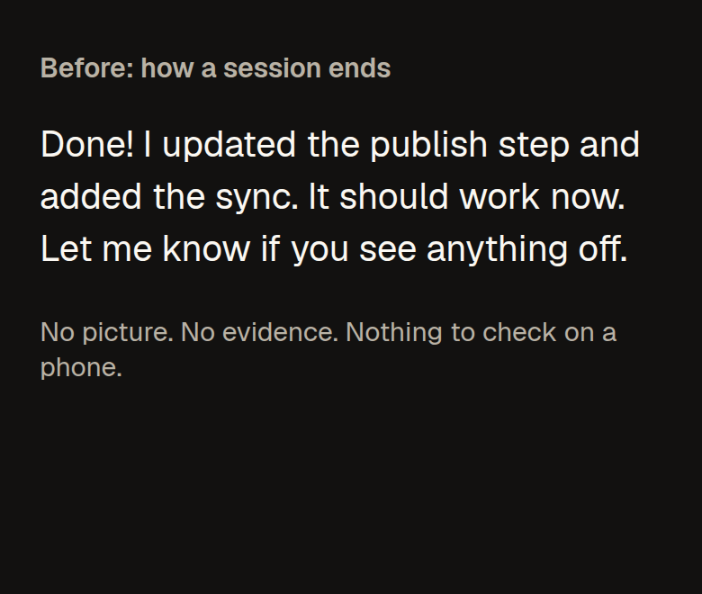
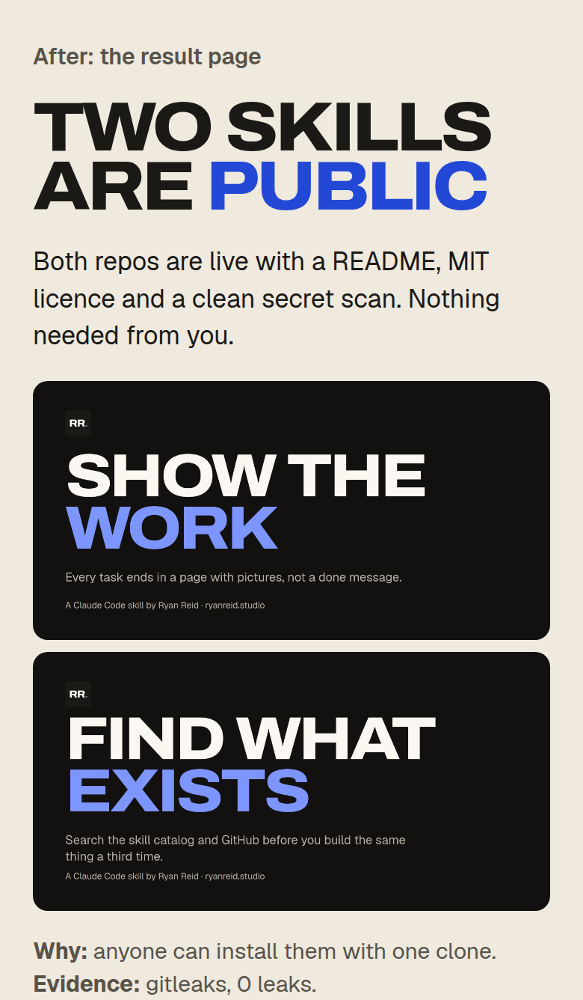

<p align="center"></p>

A Claude Code skill that makes a session end with a page you can open on your phone, with pictures, instead of a "done" message.

## Install

```bash
git clone https://github.com/RyanWReid/show-the-work ~/.claude/skills/show-the-work
```

Claude Code picks it up on the next session. It loads when a task produced something you should see or decide on.

## What it does

Every substantial task ends with a result page that has:

1. A one-line outcome, and the one thing needed from you (or "nothing").
2. Pictures. Before and after screenshots for UI work (390 px first, then 1440), real photos for places, a chart when there are more than about five numbers.
3. The reason for each change, in plain words.
4. Evidence: links, test output quoted from the log, prices with the time they were checked.
5. Open questions as a short list.

The reply in chat stays at three to five lines. The page carries the detail.

## Example

<table>
<tr>
<td width="50%"></td>
<td width="50%"></td>
</tr>
<tr>
<td>Before: a session ends with text and nothing to check.</td>
<td>After: the result page, with a picture, the reason and the evidence.</td>
</tr>
</table>

These two screens were made for the job that published this repo.

## Notes

- If something was not checked, the page says "not verified" next to it.
- No credentials, tokens or private details go on a page.
- The skill publishes with whatever page tool you have. It does not require a specific one.

## About

I build with AI every day and show what held up. More at [ryanreid.studio](https://ryanreid.studio).

MIT licence.
