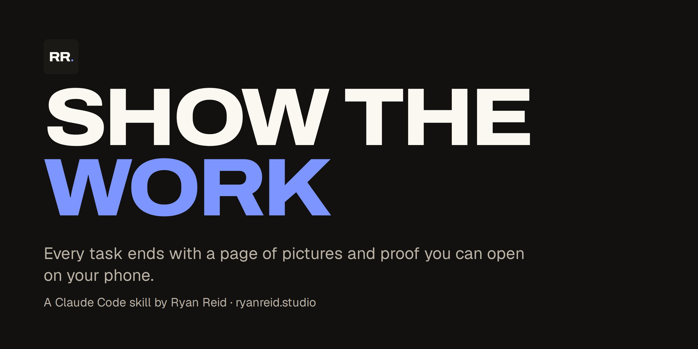
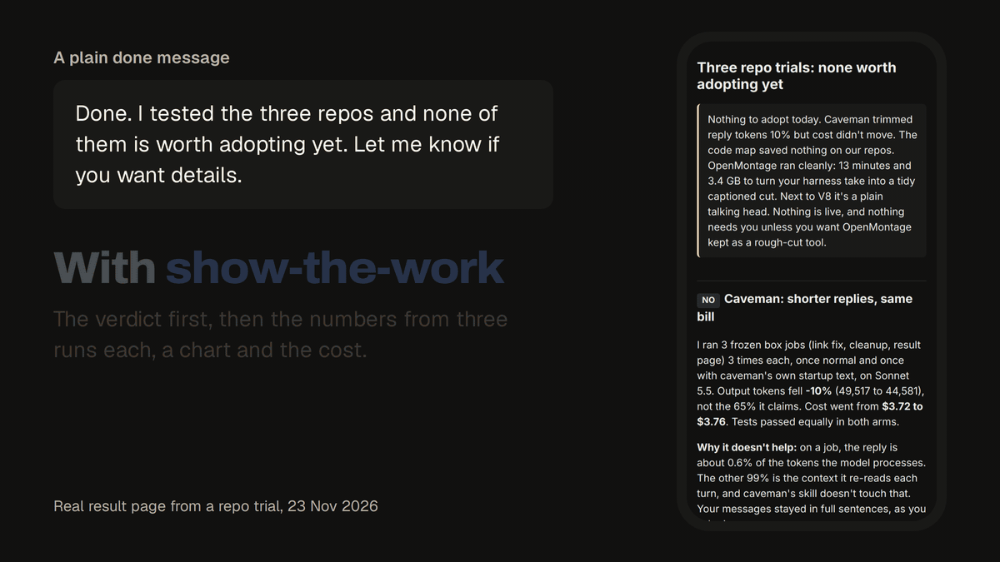

<!-- Generated by build_readme.py from template/README.md.tmpl and show-the-work/readme.toml. Edit those, not this file. -->
<p align="center"></p>

<p align="center">
  <a href="https://code.claude.com/docs/en/skills"></a>
  <a href="LICENSE"></a>
  <a href="https://github.com/RyanWReid/show-the-work/stargazers"></a>
</p>

<p align="center"><b>Claude Code ends each task with a result page you can check on your phone.</b><br>Pictures first, then the reason for each change and the proof.</p>

<p align="center"><a href="#install">Install</a> · <a href="#use">Use</a> · <a href="#example">Example</a> · <a href="#how-it-works">How it works</a></p>

## Install

```bash
git clone https://github.com/RyanWReid/show-the-work ~/.claude/skills/show-the-work
```

Start a new Claude Code session. The skill loads by itself when a task produced something you should see or decide on.

## Use

Work as usual. When a task is done, Claude publishes a page and replies in three to five lines with the link.

You can also ask for it:

> Show the work for this change.

## Example

<p align="center"></p>

Left, the kind of reply a session usually ends with. Right, the real result page from a test of three GitHub repos on 23 November 2026, scrolled at phone width. It opens on the verdict, then shows the token counts from three runs of each job, a chart and the cost in dollars.

## How it works

Every result page has five parts.

1. **Outcome.** One line: what happened, and the one thing needed from you (or "nothing").
2. **Pictures.** Before and after screenshots for UI work, at 390 px first and then 1440. Real photos for places. A chart when there are more than about five numbers.
3. **Why.** The reason for each change, in plain words.
4. **Proof.** Links, test output quoted from the log, prices with the time they were checked.
5. **Open questions.** A short list at the end.

Anything that was not checked says "not verified" next to it. Credentials, tokens and private details stay off the page. Pages are published with Claude's Artifact tool; any page you can open on a phone works too.

## By Ryan Reid


I build with AI every day and show you what actually held up, with the receipts. More at **[ryanreid.studio](https://ryanreid.studio)**.

Also by me: [find-existing](https://github.com/RyanWReid/find-existing), which makes Claude search published skills and GitHub before it builds a new tool.

<br clear="left">

MIT license.
